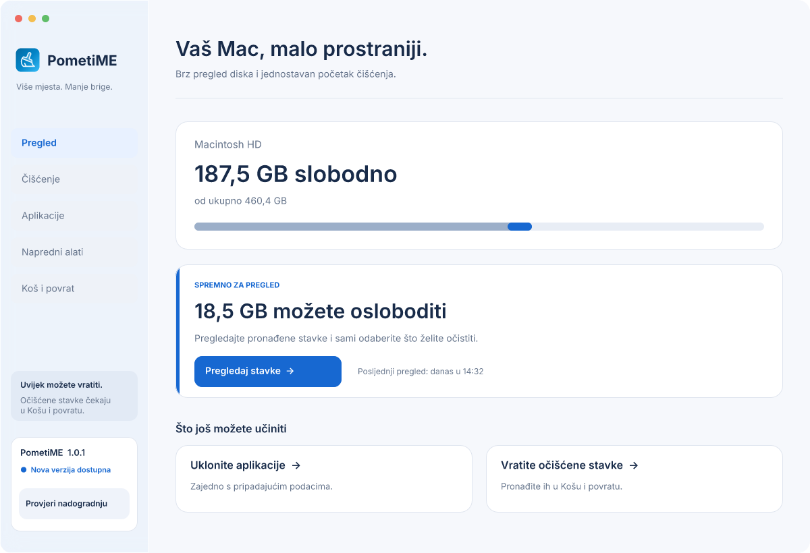

# PometiME

[](https://joinup.ec.europa.eu/collection/eupl/eupl-text-eupl-12)

**PometiME** je nativna macOS aplikacija napisana u Go-u i Cocoa/WebKit-u za sigurno čišćenje diska, razvojnih i AI predmemorija te potpunu deinstalaciju aplikacija s njihovim ostacima u `~/Library`.



*Prikaz odobrenog FigCraft redizajna. Novo sučelje još nije implementirano u aplikaciji; brojevi na prikazu služe kao primjer.*

## Novo sučelje

Redizajn donosi jasniju navigaciju kroz **Pregled**, **Čišćenje**, **Aplikacije**, **Napredne alate** te **Koš i povrat**. Postojeća ikonica četke ostaje znak aplikacije, uz plave naglaske i suptilan stakleni izgled navigacije, akcijskih traka i dijaloga.

Predviđeni su kratki prijelazi i funkcionalne animacije, uz poštovanje postavki smanjenog kretanja i prozirnosti. Dizajn obuhvaća i provjeru nadogradnje, dostupnu verziju, instalaciju te prikaze uspjeha i pogrešaka.

- [FigCraft dokument: ekrani, nadogradnje i smjernice za animacije](docs/PometiME-redizajn.figcraft)
- [Prikaz dijaloga nadogradnje](docs/PometiME-nadogradnja.png)
- [Snimka postojećeg sučelja aplikacije](docs/screenshot.png)

## Značajke

- **Pregled i Brzo Čišćenje:** Prikaz slobodnog prostora na disku i preporučene stavke za sigurno oslobađanje prostora.
- **Koš za smeće i Povrat (Undo):** Sve obrisane stavke premještaju se u `~/.Trash` uz evidenciju u `~/.pometime_trash.json`. Jednim klikom moguće je vratiti bilo koju stavku natrag na izvorno mjesto.
- **Predmemorija i Zapisnici:** Čišćenje `~/Library/Caches` i `~/Library/Logs` uz automatsku zaštitu osjetljivih sustavskih mapa (`com.apple.*`, `CloudKit`).
- **Razvojni i AI Alati:** Čišćenje predmemorija za Go, Homebrew, NPM, Python Pip, Rust Cargo i završenih Claude Code sesija (`subagents`, `tool-results`) uz trajnu zaštitu mape `memory`.
- **Ostaci Aplikacija:** Pronalazak zaboravljenih mapa u `~/Library/Application Support`, `Saved Application State`, `WebKit` i `HTTPStorages` koje ne pripadaju nijednoj instaliranoj aplikaciji.
- **Deinstalater Aplikacija:** Potpuno uklanjanje `.app` paketa iz `/Applications` i `~/Applications` zajedno sa svim pripadajućim podacima u `~/Library`.
- **Kopije i Privici:** Otkrivanje i čišćenje starih iOS sigurnosnih kopija (`MobileSync/Backup`) te keširanih privitaka aplikacije Mail (`Mail Downloads`).
- **Optimizacija i Ubrzanje Sustava:** Detekcija zaostalih pokretača (LaunchAgents) bez instaliranog programa te brzo osvježavanje sistemske predmemorije (pražnjenje DNS-a i reset QuickLook međuspremnika/ikona).
- **Nadogradnja aplikacije:** Provjera novih izdanja na GitHubu, pregled bilješki uz izdanje te preuzimanje i instalacija nadogradnje iz aplikacije.

## Izgradnja i pokretanje

```bash
# Izgradnja nativnog macOS paketa dist/PometiME.app
make app

# Pokretanje aplikacije
open dist/PometiME.app

# Provjera kvalitete koda (STATUS: HEALTHY)
make quality
```

## Licenca

Ovaj projekt licenciran je pod uvjetima **European Union Public Licence v. 1.2 (EUPL-1.2)**.
Pojedinosti pročitajte u datoteci [LICENSE](LICENSE).
