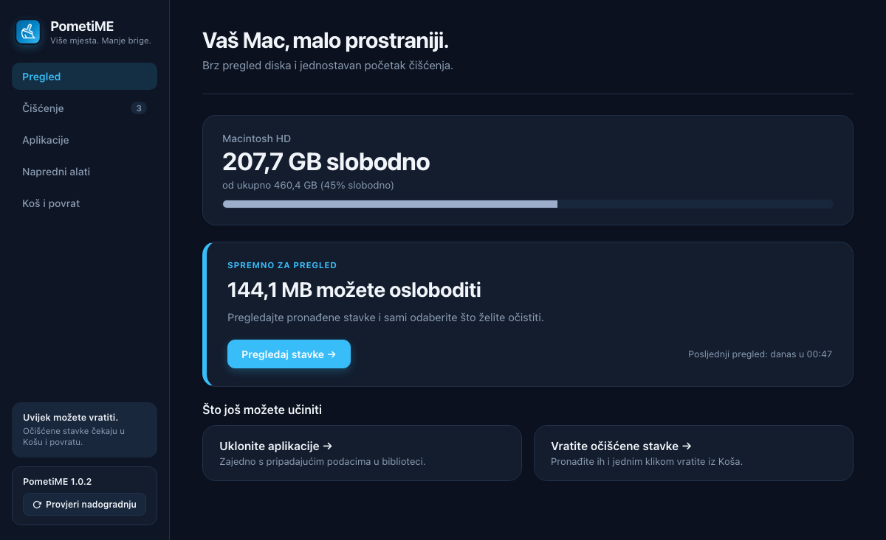
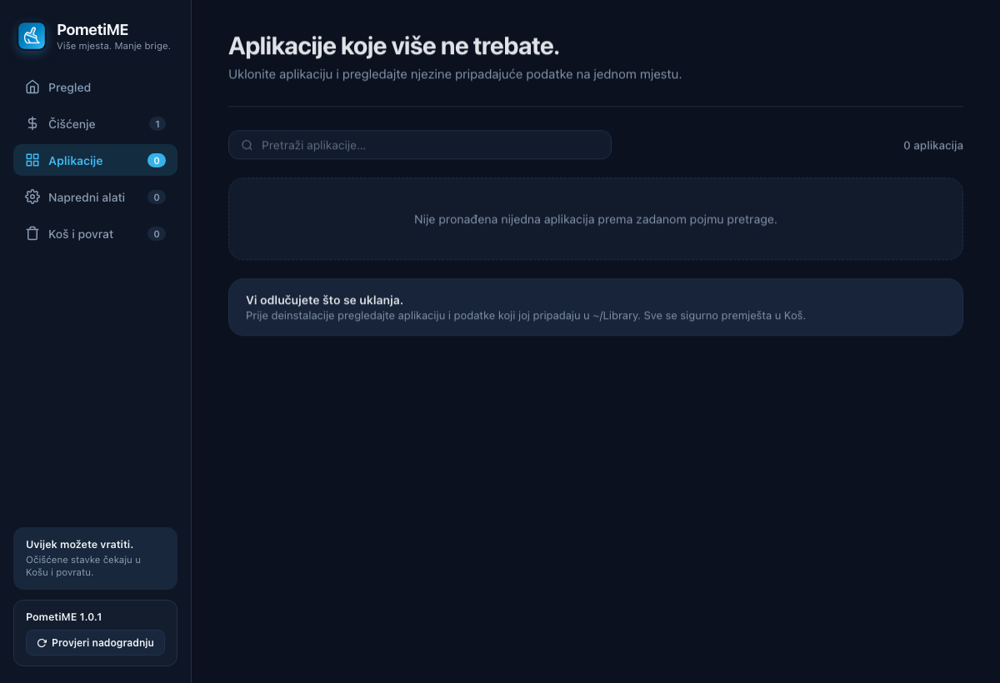

# PometiME

[](https://joinup.ec.europa.eu/collection/eupl/eupl-text-eupl-12)

**PometiME** je jednostavan i siguran čistač diska za macOS. Pomaže vam osloboditi prostor od privremenih datoteka, razvojnih predmemorija i zaostalih podataka aplikacija — bez straha od slučajnog brisanja važnih stvari.

Sve što se očisti prvo ide u **Koš za smeće** (`~/.Trash`), pa ako vam bilo što ikad ponovno zatreba, možete to vratiti jednim klikom.



*Snimka pokrenute aplikacije PometiME 1.0.8 od 8. studenoga 2026. Prikazane veličine ovise o stanju diska.*

## Kako radi

Sučelje je podijeljeno na šest jednostavnih cjelina:

1. **Pregled** — Brzi uvid u stanje diska (Macintosh HD) i preporuka koliko prostora možete odmah osloboditi.
2. **Čišćenje** — Popis privremenih datoteka, predmemorije aplikacija i sustava. Preporučene stavke već su označene, a prije čišćenja možete pregledati svaku pojedinost.
3. **Zauzeće prostora** — Najveće mape i datoteke u vašoj korisničkoj mapi, poredane po veličini. Kliknite mapu da vidite što je u njoj, a stavku otvorite u Finderu. Ovdje se ništa ne briše.
4. **Aplikacije** — Pregled instaliranih programa s njihovim izvornim macOS ikonicama. Ikonice se učitavaju lokalno iz aplikacijskih paketa ili preko sistemskog servisa, uz zamjensku ikonicu ako dohvat nije moguć. Prije uklanjanja možete pregledati pripadajuće podatke pronađene u mapi `~/Library`.
5. **Napredni alati** — Dodatno održavanje kada vam zatreba:
   - *Razvojni i AI alati*: čišćenje međuspremnika za Xcode, Go, Rust Cargo, NPM, Python, kao i zaostalih iOS simulatora, Android emulatora i Claude Code sesija (uz trajnu zaštitu memorije).
   - *Ostaci aplikacija*: brisanje mapa programa koje ste ranije deinstalirali.
   - *Kopije i privici*: stare iOS sigurnosne kopije i preuzeti privici Maila.
   - *Stari instaleri*: preuzete `.dmg` i `.pkg` datoteke u mapi Preuzimanja.
   - *Održavanje sustava*: pražnjenje DNS-a, osvježavanje QuickLooka, proređivanje Time Machine snimaka i čišćenje 4K pozadina.
6. **Koš i povrat** — Popis svih stavki koje je PometiME premjestio u Koš. Jedan klik na *Vrati odabrano* vraća datoteke točno tamo gdje su bile. Prostor se oslobađa tek kad stavke trajno izbrišete gumbom *Trajno izbriši*; stavke starije od 7 dana su istaknute.

Sučelje koristi plave naglaske, izvornu ikonicu četke i usklađene SVG ikonice naprednih alata. Podržava svijetli i tamni izgled te kratke prijelaze uz postavke smanjenog kretanja i prozirnosti.



## Sigurnost na prvom mjestu

- **Nema trajnog brisanja bez Koša**: Sve očišćene stavke idu u vaš macOS Koš.
- **Zaštićene mape**: PometiME automatski štiti osjetljive datoteke sustava (`com.apple.*`, `CloudKit`, Claude `memory` mape).
- **Naredbe samo iz vlastitog prozora**: Sučelje i čistač razgovaraju preko lokalnog poslužitelja na adresi 127.0.0.1. Poslužitelj pri svakom pokretanju dobije novi ključ i odbija zahtjev bez njega, pa datoteke ne može premjestiti ni web-stranica ni drugi program na računalu.
- **Bez vanjskih ovisnosti**: Izrađen u čistom Go standardnom paketu i Cocoa/WebKit sučelju — lagan, brz i otvorenog koda.
- **Automatska nadogradnja**: Provjerite nova izdanja i ažurirajte aplikaciju izravno iz sučelja. PometiME sam preuzima zadnje izdanje s GitHuba i instalira ga samo ako je arhiva potpisana ključem izdanja. Od verzije 1.0.8, nakon uspješne instalacije gumb **Ponovno pokreni PometiME** zatvara staru instancu i otvara nadograđenu aplikaciju. Pri prvom prijelazu sa starije verzije i dalje je potrebno ručno ponovno pokretanje.

## Preuzimanje i pokretanje

Najnoviju verziju možete preuzeti na stranici [GitHub Izdanja](https://github.com/tkraljevic/PometiME/releases).

**Prijelaz s verzija 1.0.2–1.0.5:** zbog greške u starom sučelju nadogradnje potrebno je jednom ručno preuzeti verziju 1.0.6 ili noviju, zatvoriti PometiME i zamijeniti aplikaciju u mapi Aplikacije. U novijem izdanju ispravljeno je prepoznavanje dostupne nadogradnje i slanje zahtjeva za instalaciju.

Ako želite sami izgraditi aplikaciju iz koda:

```bash
# Izgradnja macOS aplikacije (dist/PometiME.app i dist/PometiME-macOS.zip)
make app

# Pokretanje
open dist/PometiME.app

# Provjera kvalitete koda (STATUS: HEALTHY)
make quality

# Regresijski testovi sučelja (Node.js)
node --test dev/ui/*.test.cjs
```

Za razvoj bez paketa aplikacije pokrenite `make run`. Poslužitelj ispiše redak `POMETIME_URL=…` s ključem sesije. Otvorite baš tu adresu u pregledniku, jer bez ključa sučelje ne može ništa učitati.

## Izdavanje nove verzije

1. Povećajte verziju u `build/Info.plist` i u `internal/cistac/nadogradnja.go` (`TrenutnaInacica`).
2. Izgradite aplikaciju: `make app`.
3. Potpišite arhivu: `make potpisi`. Nastaje `dist/PometiME-macOS.zip.sig`.
4. Uz izdanje na GitHubu objavite obje datoteke, `PometiME-macOS.zip` i `PometiME-macOS.zip.sig`. Izdanje bez potpisa aplikacija nudi samo za ručno preuzimanje.

Tajni ključ za potpis nalazi se u `~/.config/pometime/nadogradnja-ed25519.key` i nije u repozitoriju. Čuvajte sigurnosnu kopiju, na primjer u upravitelju lozinki. Bez tog ključa instalirane aplikacije ne mogu prihvatiti nadogradnju, pa bi ih svi korisnici morali jednom zamijeniti ručno. Ako ključ procuri, izradite novi (`cd dev/potpis && go run . novi-kljuc -kljuc PUTANJA`), upišite ispisani javni ključ u `internal/cistac/nadogradnja.go` i to izdanje objavite za ručno preuzimanje.

## Licenca

Ovaj projekt licenciran je pod uvjetima **European Union Public Licence v. 1.2 (EUPL-1.2)**.
Pojedinosti pročitajte u datoteci [LICENSE](LICENSE).
